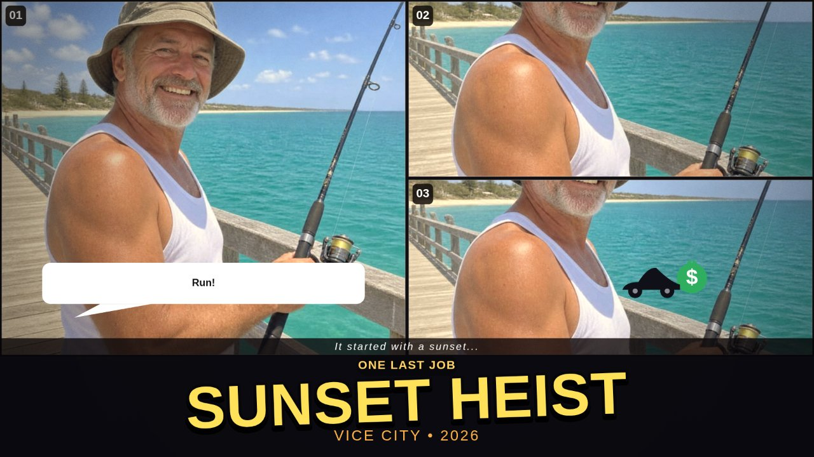
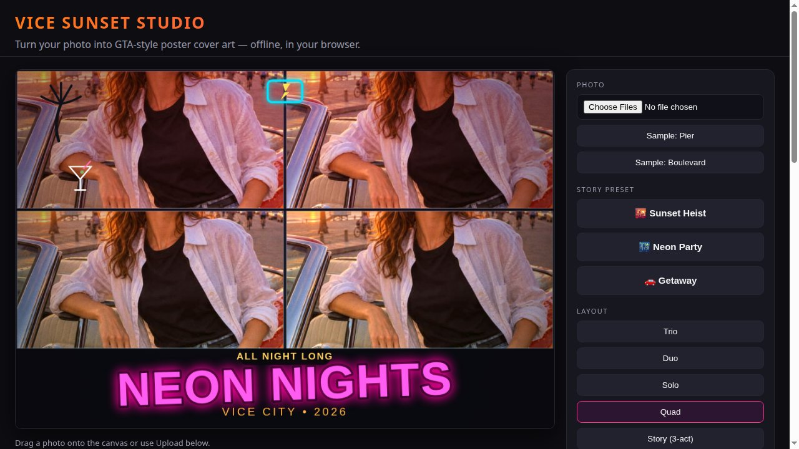

# Vice Sunset Studio

[](https://make.fun/bounty/gta6-cover-art-01)
[](https://make.fun/bounty/gta6-cover-art-01)
[](https://make.fun/bounty/gta6-cover-art-01)

Vice Sunset Studio turns any photo and a caption into GTA 6-style poster cover art — multi-panel layouts, bold lettering, Vice City sunset and neon grades — fully offline in your desktop browser, exported as a shareable PNG. Story Mode goes further: one click turns the cover into a 3-act comic story with themed presets, chapter panels, and stickers.

## What it does

- 5 layouts: Trio, Duo, Solo, Quad and Story (3-act comic with chapter badges 01/02/03 and a story caption strip).
- 5 colour grades: Sunset, Neon, Golden Hour, Noir and Comic Ink (halftone print look).
- 3 Story Presets — Sunset Heist, Neon Party, Getaway — each re-themes the whole cover in one click (grade, layout, tagline, title style, stickers).
- Giant cinematic title with gradient fills, tagline pill, and a 'starring' credits line; long titles auto-fit so they never overflow.
- 9 story stickers drawn in code (palm, flamingo, sunglasses, money bag, police lights, getaway car, sun, cocktail, neon sign).
- Letterbox cinematic bars and a speech-bubble caption.
- 'Surprise me' shuffle for one-click variety.
- Upload your own photo or use the two built-in samples.
- Drag to pan, a zoom slider, and a fit/fill toggle.
- Editable title and subtitle.
- One-click PNG export in 1080x1080, 1080x1350 and 1920x1080.
- 100% offline — photos never leave the machine.
- System fonts only; all art and lettering are original, with no Rockstar Games logo, artwork or fonts.

## Screenshots





## Run it

Requires Node.js 22.18 or later. From the repository root:

```sh
node serve.ts
```

Then open http://localhost:8080 in desktop Chrome.

## How to use

1. Open the app and pick a sample photo or upload your own.
2. Choose a layout and a grade, edit the title and subtitle.
3. Pick a Story Preset (or hit Surprise me), then export.
4. Export a PNG in your post size.

## Built with make.fun

Built for the gta6-cover-art-01 bounty on make.fun — https://make.fun/r/cyawxz65

## License

MIT
